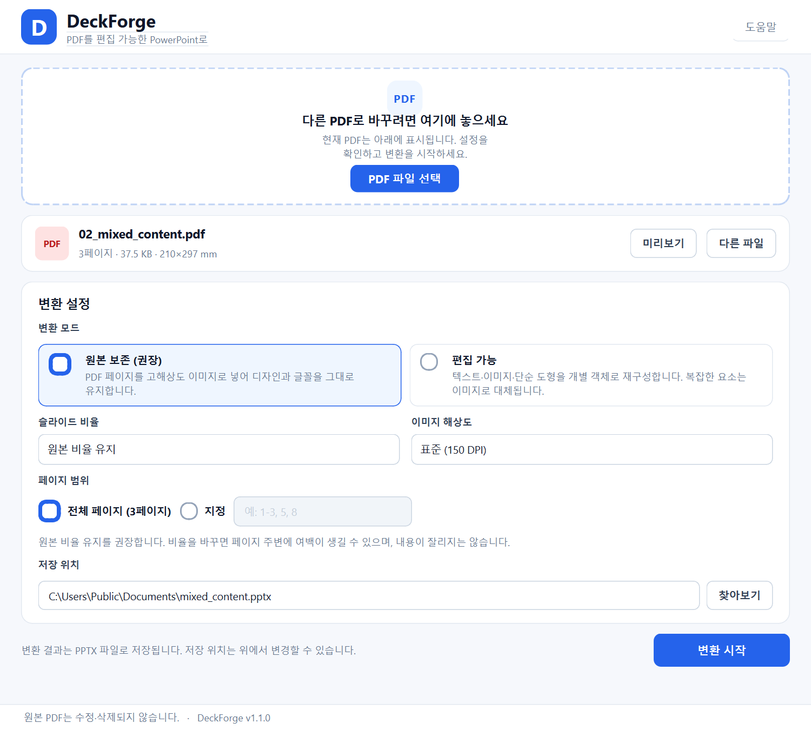

# SlideBridge — PDF to PowerPoint Converter

PDF 문서를 PowerPoint(`.pptx`)로 변환하는 Windows 데스크톱 프로그램입니다.
원본 디자인을 그대로 살리는 **원본 보존 모드**를 기본으로 제공하고, 텍스트와
이미지를 개별 객체로 재구성하는 **편집 가능 모드**를 선택할 수 있습니다.



> **Windows 실행 파일 다운로드:** <https://github.com/kaiytr/pdf_to_pptx/releases/latest/download/SlideBridge.exe>
> — 단일 `.exe`, Python 설치 불필요, 약 75MB
>
> 웹 소개 페이지: <https://kaiytr.github.io/pdf_to_pptx/>

---

## 1. 현재 구현 상태

| 항목 | 상태 |
|---|---|
| PDF 불러오기 / 드래그 앤 드롭 | 완료 |
| 원본 보존 모드 (페이지 이미지 → 슬라이드) | 완료 |
| 편집 가능 모드 (텍스트·이미지·단순 도형) | 완료 |
| 슬라이드 비율 (원본 / 16:9 / 4:3) | 완료 |
| 이미지 해상도 (150 / 300 DPI) | 완료 |
| 페이지 범위 지정 | 완료 |
| 진행률 표시 / 취소 / 부분 실패 표시 | 완료 |
| 암호 PDF | 완료 (암호 입력) |
| 저장 위치 열기 / 원본 PDF 미리보기 | 완료 |
| PPTX 생성 후 재오픈 검증 | 완료 |
| 자동화 테스트 | 완료 (73개) |
| Windows 실행 파일 | 완료 (단일 exe 빌드·실행 확인, 클린 PC 미검증) |

> **검증 환경**: Windows 11, Python 3.11.9, PySide6 6.9.3, PyMuPDF 1.26.7,
> python-pptx 1.0.2, Pillow 13.0.0, pytest 9.1.1.
> 이 환경에 Microsoft PowerPoint/LibreOffice가 없어 **실제 PowerPoint에서의
> 육안 확인은 수행하지 못했습니다.** 대신 생성 파일을 python-pptx로 다시 열고
> ZIP/OPC 필수 구성 요소와 슬라이드 수를 검증했습니다.

---

## 2. 주요 기능

### 2.1 변환 모드

| 모드 | 동작 | 편집 가능 여부 | 권장 용도 |
|---|---|---|---|
| **원본 보존** (기본) | 각 페이지를 고해상도 PNG로 렌더링해 슬라이드에 삽입 | 텍스트 편집 불가 | 디자인·글꼴·도형을 그대로 보존 |
| **편집 가능** | PDF의 텍스트, 이미지, 사각형·선·단순 경로를 개별 객체로 재구성 | 지원 범위 내 편집 가능 | 문구 수정, 이미지 교체 |

### 2.2 변환 설정

- **슬라이드 비율**: 원본 비율 유지(기본) / 16:9 / 4:3
  - 비율을 바꾸면 페이지 전체가 들어가도록 배치하며, 남는 공간은 여백으로
    처리합니다. 내용을 잘라내지 않습니다.
  - 페이지마다 크기가 다른 PDF는 첫 페이지 비율을 기준으로 하며, 다른 크기의
    페이지는 여백과 함께 배치됩니다.
- **이미지 해상도**: 표준(150 DPI) / 고품질(300 DPI)
- **페이지 범위**: 전체 또는 `1-3, 5, 8` 형식
- **출력 파일명/위치**: 저장 대화상자 또는 직접 입력
- **암호 PDF**: 변환 전에 암호를 최대 3회까지 입력

### 2.3 진행·오류 처리

- 페이지 단위 진행률과 현재 페이지 표시
- 작업 스레드에서 변환하여 UI 멈춤 방지
- 변환 중 취소 (현재 페이지 처리가 끝난 뒤 안전하게 중단)
- 일부 페이지만 실패해도 나머지 페이지로 PPTX를 생성하고, 실패 페이지와
  원인을 완료 화면에 표시
- 출력 파일을 임시 경로에 저장한 뒤 검증하고 최종 위치로 이동
- 실패/취소 시 임시 파일 정리
- 원본 PDF는 읽기만 하며 수정·삭제하지 않음

---

## 3. 설치 및 실행

### 3.1 실행 파일로 실행 (권장)

[Windows용 SlideBridge.exe 다운로드](https://github.com/kaiytr/pdf_to_pptx/releases/latest/download/SlideBridge.exe)

- 단일 `.exe` 파일이며 Python 설치가 필요 없습니다.
- Windows 10/11 64비트에서 실행하세요.
- 서명되지 않은 파일이라 Windows SmartScreen 경고가 표시될 수 있습니다.
  **추가 정보 → 실행**을 선택하면 됩니다.
- 다운로드한 파일을 원하는 폴더에 두고 더블클릭하면 실행됩니다.

### 3.2 소스에서 실행할 때의 요구 사항

- Windows 10/11 (64비트)
- Python 3.11 이상 권장 (개발 환경: 3.11.9)
- 약 300MB 이상의 여유 공간 (PySide6 포함)

> Python 3.12/3.13에서도 동작할 것으로 예상하지만, 이 저장소에서는 3.11.9로만
> 검증했습니다. 3.8 이하에서는 동작하지 않습니다.

### 3.3 소스 설치

PowerShell에서 프로젝트 루트로 이동한 뒤:

```powershell
py -3.11 -m venv .venv
.\.venv\Scripts\Activate.ps1
python -m pip install --upgrade pip
python -m pip install -r requirements.txt
```

PowerShell 실행 정책 때문에 활성화가 막히면 다음 중 하나를 사용합니다.

```powershell
Set-ExecutionPolicy -Scope Process -ExecutionPolicy Bypass
# 또는 가상환경을 활성화하지 않고 직접 실행
.\.venv\Scripts\python.exe -m pip install -r requirements.txt
```

### 3.4 소스 실행

```powershell
python main.py
```

가상환경을 활성화하지 않았다면:

```powershell
.\.venv\Scripts\python.exe main.py
```

### 3.5 사용 순서

1. PDF를 창에 끌어다 놓거나 **PDF 파일 선택**을 누릅니다.
2. 파일명, 페이지 수, 용량, 페이지 크기와 분석 경고를 확인합니다.
3. 변환 모드, 비율, 해상도, 페이지 범위, 저장 위치를 설정합니다.
4. **변환 시작**을 누릅니다. 필요하면 **취소**로 중단할 수 있습니다.
5. 완료 화면에서 **저장 위치 열기**로 폴더를 열고 PowerPoint에서 확인합니다.
6. 다른 파일을 변환하려면 **새 파일 변환**을 누릅니다.

---

## 4. 프로젝트 구조

```text
pdf_to_pptx/
├── main.py                     # 진입점, 전역 예외 처리, 앱 아이콘
├── requirements.txt
├── requirements-dev.txt        # ruff, pyinstaller
├── pyproject.toml              # pytest 설정
├── build_windows.ps1           # PyInstaller 패키징 스크립트 (미검증)
├── README.md
├── app/
│   ├── __init__.py
│   ├── ui/
│   │   ├── main_window.py      # 메인 화면, 변환 흐름, 완료 화면
│   │   ├── settings_panel.py   # 모드/비율/해상도/범위/저장 위치
│   │   ├── progress_dialog.py  # 진행 패널, PDF 미리보기 대화상자
│   │   ├── conversion_worker.py# QThread 작업자
│   │   └── theme.py            # QSS 스타일
│   ├── core/
│   │   ├── pdf_loader.py       # PDF 열기, 암호, 메타데이터
│   │   ├── pdf_analyzer.py     # 페이지/객체 분석, 경고
│   │   ├── pdf_renderer.py     # 페이지 → PNG 렌더링
│   │   ├── object_extractor.py # 텍스트/이미지/도형 추출
│   │   └── pptx_builder.py     # 좌표 변환, 슬라이드 생성
│   ├── services/
│   │   ├── conversion_service.py  # 변환 파이프라인, 진행/취소/부분 실패
│   │   └── validation_service.py  # 입력/출력/PPTX 검증
│   ├── models/
│   │   └── conversion_options.py  # 옵션, 결과, 페이지 범위 파서
│   └── utils/
│       ├── file_utils.py
│       └── error_handler.py
├── scripts/
│   └── create_samples.py       # 샘플 PDF 생성
├── samples/                    # 생성된 테스트용 PDF
├── tests/
│   ├── conftest.py             # 테스트용 PDF 픽스처
│   ├── test_pdf_loader.py
│   ├── test_conversion.py
│   ├── test_validation.py
│   ├── test_object_extractor.py
│   └── test_settings_panel.py
└── docs/
    └── screenshot.png
```

---

## 5. 처리 구조

```text
PDF 선택
  → 파일/암호/페이지 수 검증
  → 페이지·객체 분석 (UI 경고)
  → 옵션 확정, 출력 경로 사전 검증
  → QThread 작업자 시작
      → 페이지별 렌더링 또는 객체 추출
      → python-pptx 슬라이드 추가
      → 진행률 콜백 (페이지 단위)
      → 취소 이벤트 확인
  → 임시 PPTX 저장
  → ZIP/OPC 필수 파트 + python-pptx 재오픈 + 슬라이드 수 검증
  → 최종 경로로 원자적 이동 (os.replace)
  → 완료/부분 실패/오류를 UI에 표시
```

### 좌표 변환

- PDF 좌표 단위는 포인트(1/72인치)입니다.
- 슬라이드 크기는 첫 페이지와 선택 비율로 결정합니다.
- 페이지 전체가 슬라이드 안에 들어오도록 **등방성 스케일**(가로·세로 동일)을
  적용하고, 남는 공간은 중앙 여백으로 둡니다.
- 텍스트 상자 위치·크기와 글꼴 크기도 같은 스케일로 변환합니다.
- 페이지에 `/Rotate`가 설정된 경우 회전된 화면 좌표계로 객체 위치를 변환합니다.
- 16:9/4:3 선택 시에도 내용을 자르지 않습니다.

### 안전 장치

- 페이지 수 5,000 초과: 변환 거부
- 100페이지 초과 또는 200MB 초과: 사전 경고
- 원본 보존 렌더링: 페이지당 최대 약 5,000만 픽셀, 초과 시 DPI 자동 하향
- 편집 가능 이미지: 4,000만 픽셀/8,000px 초과 시 축소 후 경고
- 벡터 요소: 페이지당 최대 800개, 누적 60,000포인트로 제한
- 이미지: 페이지당 최대 400개

---

## 6. 테스트

### 6.1 자동화 테스트

```powershell
python -m pytest
```

결과 (최종 실행):

```text
73 passed
```

테스트 범위:

- 정상/손상/빈/암호 PDF 열기 및 메타데이터
- 암호 3종 상태 (필요/오류/성공)
- 페이지 범위 파서의 정상·오류 입력
- 저장 경로·PPTX ZIP/OPC·슬라이드 수 검증
- 원본 보존 모드 슬라이드 수·비율·이미지 삽입
- 편집 가능 모드 텍스트(한글 포함)·이미지·도형 생성
- 16:9/4:3/원본 비율
- 페이지 범위 순서
- 진행률 단조 증가 및 완료 이벤트
- 사전 취소 시 출력/임시 파일 미생성
- 암호 PDF 변환
- 페이지 크기가 다른 PDF
- 페이지 회전(`/Rotate` 90°) PDF의 객체 위치
- 스캔 이미지 PDF
- 편집 객체가 없을 때 이미지 대체
- 일부 페이지 실패 시 부분 슬라이드 제거 및 부분 성공
- 기존 파일 덮어쓰기
- Qt 설정 패널의 enum/페이지 범위/비활성화 상태
- 메인 윈도우의 PDF 로드·기본 저장 경로

### 6.2 샘플 PDF

```powershell
python scripts/create_samples.py
```

| 파일 | 내용 |
|---|---|
| `01_text_only.pdf` | 텍스트, 한글, 특수문자, 2페이지 |
| `02_mixed_content.pdf` | 텍스트·이미지·표·선·곡선, 3페이지 |
| `03_tables_shapes.pdf` | 표와 사각형/선이 많은 페이지 |
| `04_landscape.pdf` | 가로형 2페이지 |
| `05_many_pages.pdf` | 20페이지 진행률/범위 테스트 |
| `06_encrypted.pdf` | 암호 PDF (암호: `slidebridge`) |
| `07_large_image.pdf` | 3600×2400 이미지 포함 |

### 6.3 수동 확인 결과

- 위 7개 샘플을 원본 보존/편집 가능 모드로 변환 → 14개 PPTX 모두 생성 및
  python-pptx 재오픈 성공
- 암호 PDF에 암호를 입력해 변환 성공
- 20페이지 샘플의 `1-5` 범위 변환 → 5장 생성
- UI에서 파일 로드, 설정 변경, 변환, 완료 화면, 취소, 미리보기 동작 확인
- 취소 시 출력 파일과 `.slidebridge_*.pptx` 임시 파일이 남지 않음
- PyInstaller 단일 실행 파일(`dist\SlideBridge.exe`, 약 75MB) 빌드 및 실행 확인
- 패키징 환경과 동일한 구성으로 PDF → PPTX 변환 스모크 테스트 통과

**미검증 항목**

- Microsoft PowerPoint 실제 실행 환경에서의 열기/렌더링
- 원본 PDF와 변환 PPTX의 픽셀 단위 시각 비교
- 다른 클린 PC에서의 실행 파일 실행 및 코드 서명/SmartScreen 동작
- 5,000페이지급 초대형 문서, 4,000만 픽셀 초과 이미지의 실측

---

## 7. 알려진 한계와 남은 문제

### 7.1 편집 가능 모드

PDF는 시각적 표현을 저장하고 PPTX는 개별 객체를 저장하므로 1:1 변환은
불가능합니다. 현재 구현의 한계는 다음과 같습니다.

- 텍스트는 줄 단위 문단으로 재구성됩니다. 원본의 정교한 자간, 커닝, 기준선,
  bullet 서식, 다단 구성은 완전히 보존되지 않을 수 있습니다.
- 글꼴은 PPTX에 포함되지 않습니다. 대상 PC에 글꼴이 없으면 PowerPoint가
  대체 글꼴을 사용합니다.
- 그라데이션, 투명도, 블렌드 모드, 클리핑 패스, 패턴 채우기는 지원하지 않거나
  단순 색으로 대체됩니다.
- 페이지 회전(`/Rotate`)은 화면에 보이는 방향으로 반영합니다. 다만 페이지
  내부에서 개별 텍스트/이미지가 기울거나 회전된 경우, 복잡한 베지어 경로,
  마스크는 근사되거나 누락될 수 있습니다.
- 주석, 링크, 폼 필드, 디지털 서명, 스크립트는 변환하지 않습니다.
- 스캔 문서는 이미지로 들어가며 OCR을 수행하지 않습니다.
- 편집 가능한 객체를 전혀 만들지 못한 페이지만 전체 이미지로 대체합니다.
  일부 요소만 지원되지 않는 경우 해당 요소는 경고와 함께 누락될 수 있습니다.

### 7.2 원본 보존 모드

- 결과는 이미지이므로 텍스트/도형을 직접 편집할 수 없습니다.
- 고해상도(300 DPI) 다페이지 문서는 PPTX 용량이 커질 수 있습니다.

### 7.3 공통

- 페이지 크기가 다른 PDF는 첫 페이지 비율을 기준으로 합니다.
- PPTX 미리보기는 제공하지 않습니다. **원본 미리보기**는 PDF 페이지만
  표시하며, 실제 결과 확인은 PowerPoint에서 해야 합니다.
- 여러 파일을 한 번에 큐에 넣는 일괄 변환은 없습니다. **새 파일 변환**으로
  순차 처리합니다.
- Windows 실행 파일은 단일 exe로 빌드해 실행을 확인했지만, 다른 PC에서의
  실행과 코드 서명은 검증하지 않았습니다.
- 암호 PDF는 사용자가 입력한 암호로 열람 가능한 경우에만 변환합니다.
  권한 제한을 우회하지 않습니다.

---

## 8. Windows 실행 파일 패키징 (선택)

```powershell
.\build_windows.ps1
```

- 가상환경과 개발 의존성(`requirements-dev.txt`)이 필요합니다.
- 결과물: `dist\SlideBridge.exe` (단일 실행 파일)
- PyMuPDF 리소스와 python-pptx 기본 템플릿을 함께 수집합니다.
- 빌드된 exe는 개발 PC에서 실행을 확인했고, 동일한 PyInstaller 구성의
  변환 스모크 테스트도 통과했습니다.
- **주의**: 다른 클린 PC에서의 실행과 코드 서명은 검증하지 않았습니다.
  서명되지 않은 파일이라 SmartScreen 경고가 표시될 수 있습니다.

---

## 9. 문제 해결

| 증상 | 확인 사항 |
|---|---|
| 실행 파일이 차단됨 | Windows SmartScreen에서 **추가 정보 → 실행**을 선택. 서명되지 않은 빌드입니다 |
| `ModuleNotFoundError: PySide6` | 가상환경 활성화 후 `pip install -r requirements.txt` |
| 창이 뜨지 않음 | 64비트 Python인지 확인, `python main.py`를 콘솔에서 실행해 오류 확인 |
| `PDF 파일을 열 수 없습니다` | 손상/암호/확장자 확인. 암호 PDF는 프롬프트에서 입력 |
| 저장 실패 | PowerPoint에서 같은 파일을 열고 있지 않은지, 폴더 쓰기 권한 확인 |
| 한글이 다르게 보임 | 대상 PC에 원본 글꼴 설치 또는 PowerPoint 글꼴 대체 확인 |
| 변환 결과가 다름 | 편집 가능 모드의 한계(7.1) 확인. 원본 보존 모드 사용 권장 |
| 로그 확인 | `%LOCALAPPDATA%\SlideBridge\slidebridge.log` |

---

## 10. 라이선스 및 외부 라이브러리

이 저장소에는 별도 라이선스가 명시되어 있지 않습니다. 사용 전 저장소 소유자에게
확인하세요.

사용 라이브러리:

- [PySide6](https://www.qt.io/qt-for-python) — Qt for Python (LGPL/GPL/상용)
- [PyMuPDF](https://pymupdf.readthedocs.io/) — PDF 렌더링/추출 (AGPL/상용)
- [python-pptx](https://python-pptx.readthedocs.io/) — PPTX 생성 (MIT)
- [Pillow](https://python-pillow.org/) — 이미지 처리 (HPND)
- [pytest](https://pytest.org/) — 테스트 (MIT)

배포 시 각 라이브러리의 라이선스 조건을 확인해야 합니다.
